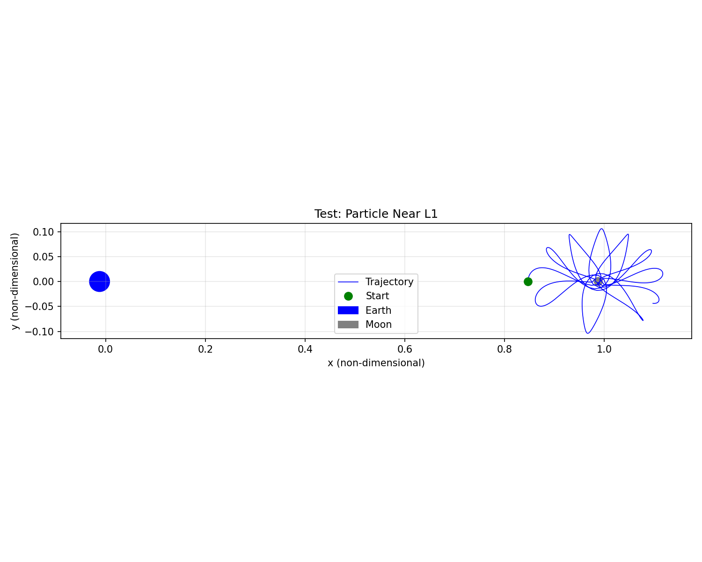
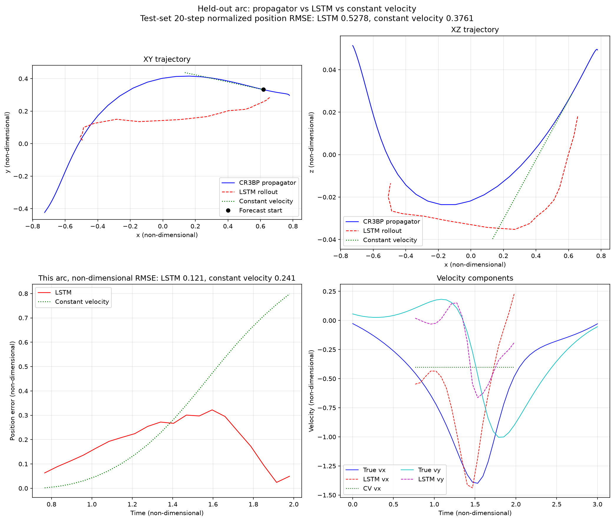

# Cislunar SSA

Open-source propagator for space situational awareness in the Earth–Moon system. States are integrated in the Circular Restricted Three-Body Problem (CR3BP): the Earth–Moon distance is 1, and the mass parameter is μ = 0.012150585609624.



## What this is

The toolkit propagates spacecraft and debris in the rotating frame, locates the Lagrange points, checks the Jacobi integral, and builds synthetic catalogs for close-approach screening. A separate PyTorch pipeline learns a one-step map from a short state history to the next CR3BP state, so a tracked object can be rolled forward and compared with the numerical integrator.

Coordinates are non-dimensional unless a routine says otherwise. Earth sits at (−μ, 0, 0) and the Moon at (1 − μ, 0, 0).

## Physics

- **CR3BP equations of motion** in the rotating frame, integrated with SciPy `RK45` (`rtol=1e-9`, `atol=1e-12`) through `physics.propagate`.
- **Lagrange points** L1–L5. The collinear points are roots of the usual quintic; L4 and L5 are the equilateral solutions. `stability_eigenvalues` returns the planar linearization at a point.
- **Jacobi integral**, the conserved energy-like quantity of the CR3BP, plus a check that it stays within a tolerance along a propagated arc.
- **Reference environments** for Earth–Moon and Sun–Earth mass ratios, with LEO and GEO constants (altitudes, periods, circular speed).
- **Validation helpers** that compare computed Lagrange points with the published NASA/JPL coordinates stored in `physics.validation`.
- **Halo orbits**: a linearized L1/L2 initial guess, and a single-shooting corrector (`orbits.halo_differential_correction.single_shooter`) that adjusts x, z, and vy so the half-period x–z crossing approaches y = vx = vz = 0. The period stays at the value passed in.
- **Perturbations**, implemented as extra accelerations: solar gravity (Sun on a circular path about the Earth–Moon barycenter) and a simplified solar-radiation-pressure term. The default `propagate` call is pure CR3BP; these accelerations are not added inside it.
- **Debris catalog** of synthetic cislunar states (id, 6-vector, size, epoch) and a pairwise conjunction screen on position distance. LEO and GEO catalog regions are not implemented.
- **Plots**: Matplotlib in the rotating frame, and Plotly figures for the 3D Earth–Moon system, debris clouds, and an animated trajectory.

Sources for the constants and the halo literature are listed in [`docs/references.md`](docs/references.md).

## AI tracking

`train_ai.py` is the training path. `train_ai_full.py` calls the same function. Both write `models/cislunar_lstm.pt`, which stores the weights together with the architecture, the z-score normalizer, and the data settings. `eval_ai.py` loads that file, rebuilds the holdout from the saved seed, and writes `models/evaluation_results.npz`. `viz_ai.py` draws that archive. Checkpoints are gitignored (`*.pt` and `models/`); reproduce them by running the scripts.

The network is a unidirectional LSTM (input 6, hidden 64, 2 layers, dropout 0.1) followed by a linear map 64 → 32, ReLU, dropout, and a linear map 32 → 6. It is trained with MSE and Adam (`1e-3`) to map 12 consecutive states to the next state. The demo settings in `train_ai.py` are a CPU run of about ten seconds:

- seed 42
- 36 arcs, t ∈ [0, 3], 48 samples (Δt = 3/47 ≈ 0.06383)
- initial position uniform on x ∈ [0.50, 1.25], y ∈ [−0.45, 0.45], z ∈ [−0.08, 0.08], velocity normal with standard deviations (0.03, 0.06, 0.02)
- arcs split by trajectory into train / validation / test (about 70% / 15% / 15%). The normalizer is fit on training states only
- up to 40 epochs, patience 8; the saved weights are the best validation epoch

On this run every arc integrated (26 train, 5 validation, 5 test, 936 training windows). Training stopped after 39 epochs. Best validation MSE on the normalized 6-vector was 0.221812. The model has 53,990 parameters.

`src/ai/trajectory_predictor.py` (`SimpleLSTMPredictor`, used by `test_ai_tracking.py`) is still a placeholder: `predict` integrates the last state with the CR3BP propagator for 0.1 time units. The package also contains an unused GRU, a physics-informed LSTM, and a second trainer from an earlier draft. They are not the path `eval_ai.py` loads.

## Results

Truth is the CR3BP propagator. The baseline is constant velocity in the rotating frame: from the last state in the window, step `x ← x + v Δt` and hold velocity fixed. The LSTM sees the full window of 12 states; the baseline sees only the last one. A propagator compared with itself has zero error, so it is the reference rather than a second forecaster.

Position RMSE in normalized units is `sqrt(mean((z_true − z_pred)^2))` on x, y, and z after the training z-score. Training standard deviations of position were about 0.641, 0.409, and 0.034, so a physical error in z is weighted more heavily than the same error in x. The table pools every test window (180 one-step windows; five rollouts of 20 steps).

| | LSTM | Constant velocity |
| --- | ---: | ---: |
| One-step position RMSE, normalized | 0.252557 | 0.003666 |
| 20-step rollout position RMSE, normalized | 0.527801 | 0.376073 |
| One-step position RMSE, non-dimensional | 0.104522 | 0.001233 |
| 20-step rollout position RMSE, non-dimensional | 0.226529 | 0.151090 |

The LSTM does not beat constant velocity. Over one sample the velocity already carries almost all of the position change (the baseline's one-step error is about 0.001 Earth–Moon distances), and this network's one-step error is about 0.10. On the 20-step rollout the baseline is still lower in both normalized and non-dimensional units.

The figure is the first held-out arc, not the pooled score. On that single arc the non-dimensional position RMSE is 0.121 for the LSTM and 0.241 for constant velocity, so the drawn arc is kinder to the network than the five-arc mean. The title states the pooled normalized rollout error.



A 3D view of the same arc is `docs/ai_vs_physics_3d.png`.

## Install

From the repository root:

```bash
pip install -r requirements.txt
```

Dependencies are NumPy, SciPy, Matplotlib, Plotly, Jupyter, pytest, PyTorch, and tqdm. There is no installable package; scripts add `src` to `sys.path` and expect to be run from the repository root.

## Usage

Propagate a state offset from L1 by +0.01 in x (toward the Moon) and check the Jacobi integral. This is the same initial condition used to draw the figure above (`test_basic.py` writes that figure to `test_trajectory.png`).

```python
import sys
sys.path.insert(0, "src")

import numpy as np
from physics import compute_lagrange_points, propagate, jacobi_integral

L = compute_lagrange_points()
state0 = [L["L1"][0] + 0.01, 0.0, 0.0, 0.0, 0.1, 0.0]
t_eval = np.linspace(0, 10, 1000)
sol = propagate(state0, (0, 10), t_eval)

print(sol.success, sol.y[:3, -1])
print(jacobi_integral(state0), jacobi_integral(sol.y[:, -1]))
```

From the repository root:

```bash
python test_basic.py           # Lagrange points, a short arc, Jacobi check, rotating-frame figure
python test_validation.py      # mass ratio, NASA/JPL Lagrange points, Jacobi check
python test_3d.py              # Plotly Earth–Moon view and debris cloud
python test_3d_research.py     # same views, with the Lagrange-point check printed
python test_professional.py    # dark-theme 3D figure and orbital-regime comparison
python test_advanced.py        # animation, placeholder predictor, halo single-shooter
python test_ai_tracking.py     # placeholder predictor and a Plotly comparison

python train_ai.py             # writes models/cislunar_lstm.pt
python train_ai_full.py        # same trainer as train_ai.py
python eval_ai.py              # scores that checkpoint, writes models/evaluation_results.npz
python viz_ai.py               # writes docs/ai_vs_physics.png and docs/ai_vs_physics_3d.png
```

## Project structure

```
├── train_ai.py              # supported LSTM trainer (CPU demo settings)
├── train_ai_full.py         # calls train_ai.main
├── eval_ai.py               # holdout score vs constant velocity
├── viz_ai.py                # propagator / LSTM / constant-velocity figures
├── test_*.py                # propagator, validation, halo, and visualization demos
├── requirements.txt
├── src/
│   ├── physics/             # CR3BP, Lagrange points, Jacobi, environments, validation
│   ├── orbits/              # halo initial guess and single-shooter
│   ├── perturbations/       # solar gravity and radiation pressure
│   ├── debris/              # synthetic catalog and conjunction screen
│   ├── ai/                  # LSTM trainer plus earlier unused model drafts
│   └── viz/                 # rotating-frame, Plotly 3D, animation
├── docs/                    # HTML views, references, trajectory and tracking figures
├── data/
│   ├── nasa_ephemerides/    # placeholder
│   └── synthetic_debris/    # placeholder
└── tests/                   # package marker only; demos live at the repo root
```

`models/` and `*.pt` are gitignored. A previous `best_model.pt` at the repository root was a 3-layer, hidden-256 state dict that no script wrote or loaded; it has been removed.

## Next steps

- Teach the next-state model the velocity carry (for example by predicting the increment `x_{k+1} - x_k`) so a short rollout can beat constant velocity. The demo above does not.
- Add the solar-gravity and radiation-pressure accelerations inside the propagator, with a switch to turn them off.
- Fill `data/nasa_ephemerides/` and check halo families from the single-shooter against published NRHO and Gateway orbits.
- Implement the LEO and GEO branches of the debris catalog. `generate_debris_catalog` currently raises `NotImplementedError` for those regions.
- Replace `SimpleLSTMPredictor` with the trained network so `test_ai_tracking.py` rolls out `models/cislunar_lstm.pt`.
